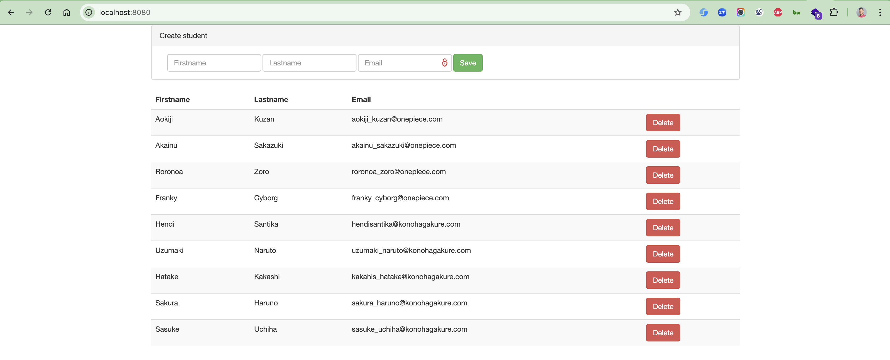

# SpringBootReact

[](https://github.com/hendisantika/SpringBootReact/actions/workflows/maven.yml)


Spring Boot + React.js

Simple CRUD application with a Spring Boot Data REST backend and a React.js frontend.
The application uses an in-memory H2 database and is pre-loaded with demo data.

## Tech Stack

* Java 25
* Spring Boot 4.1.1 (Web, Data REST, Data JPA, Actuator, DevTools)
* H2 (in-memory database)
* React.js (served as static resources)
* Dekorate (Kubernetes manifests), Jib (container image), App Engine plugin

## Requirements

* JDK 25 (e.g. [Eclipse Temurin 25](https://adoptium.net/))
* No Maven installation needed — use the bundled Maven Wrapper (`mvnw`)

## Getting Started

Run the application:

```shell
./mvnw clean spring-boot:run
```

Then open:

| URL                                      | Description                    |
|------------------------------------------|--------------------------------|
| http://localhost:8080                    | React frontend                 |
| http://localhost:8080/api/students       | Spring Data REST students API  |
| http://localhost:8080/actuator/health    | Actuator health endpoint       |

Build and run the tests:

```shell
./mvnw clean verify
```

Build a container image with Jib (base image `eclipse-temurin:25-jre`):

```shell
./mvnw compile jib:dockerBuild
```

## CI & Dependency Updates

* **GitHub Actions** (`.github/workflows/maven.yml`) builds and tests every push and pull request
  to `master` on Temurin JDK 25. On pushes to `master` the Maven dependency graph is submitted to
  GitHub to improve Dependabot alerts.
* **Dependabot** (`.github/dependabot.yml`) checks Maven dependencies and GitHub Actions daily
  (05:00 Asia/Jakarta). Updates are grouped (Spring Boot, Google Cloud tools, Dekorate,
  minor/patch, GitHub Actions) and labelled, using conventional commit prefixes
  (`build(deps): ...` / `ci(deps): ...`).

## Screenshot


